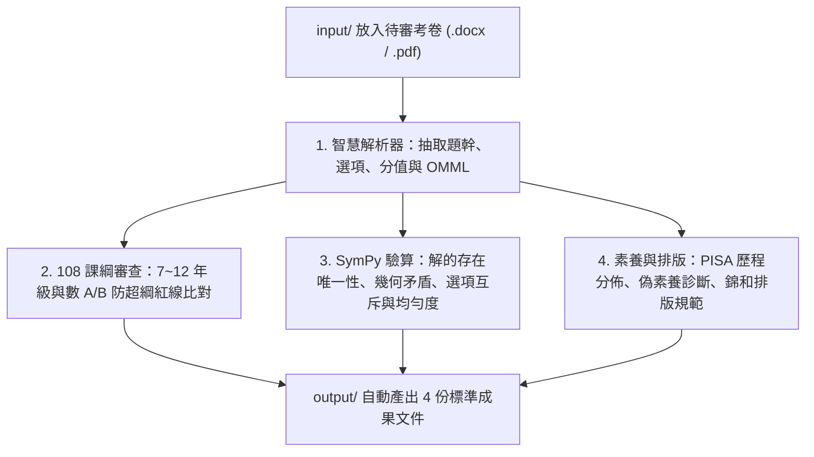

# 國高中數學科 108 課綱素養命題與自動化審題技能 (jhsh-math-exam-reviewer)

本 Skill 專門用於輔助國高中數學教師進行段考自動化審題。教師只需將待審考卷（Word `.docx` 或 PDF `.pdf`）放入 `input/` 資料夾，即可全自動執行：
1. **108 課綱防超綱紅線檢核**：嚴格篩查 7~12 年級與數 A/B 刪減內容（如弦切角、圓冪定理、負整數指數、未知數絕對值方程、三次乘法公式等）。
2. **SymPy 符號運算 100% 驗算**：驗證解的存在性（防無解）、唯一性、幾何三角不等式與畢氏定理矛盾、單選題選項互斥性與選項 ABCD 分佈均衡度。
3. **PISA 四歷程與偽素養文字比**：判定 $M_1 \sim M_4$ 歷程分佈，診斷包裝型「偽素養」過度冗長題目。
4. **錦和高中標準排版檢核與修訂**：自動產出符合 1cm 邊界、標楷體、題號凸排 0.28 吋、出題範圍靠右不加粗、單頁 A4 答案卷之審題報告與修訂考卷至 `output/`。

---

## 快速開始：教師提詞標準範例 (Teacher Prompt Templates)

> [!TIP]
> **教師可直接複製以下提詞至對話框執行：**

### 範例 1：最常用「一鍵全自動審題」（推薦）
```text
我已經把待審考卷放入 input 資料夾，請使用 jhsh-math-exam-reviewer 技能對它進行全面自動化審題，並將審題診斷報告、雙向細目表、SymPy 驗算結果與修訂版考卷輸出至 output 資料夾。
```

### 範例 2：指定年級與重點章節審查
```text
請使用 jhsh-math-exam-reviewer 技能審查 input/ 內的段考試卷：
1、試卷年級：國中部九年級
2、出題範圍：第 3 章 幾何與證明（3-1證明與推理、3-2三角形的外心、內心與重心）
3、審題重點：請特別加強「108 課綱防超綱紅線（如弦切角、圓冪定理）」與「非選題 0~3 級分規準」審查，並輸出符合錦和高中格式的 4 份報告至 output/。
```

### 範例 3：考卷與範圍規劃文件「交叉比對」
```text
我在 input/ 放了兩個檔案：
1、考卷：`115上國八數學段二試題.pdf`
2、範圍參考資料：`國八段二雙向細目與配分規範.docx`
請比對兩者，檢核實際考題是否超出範圍資料的規劃、配分與題數是否吻合，並檢查是否有無解或題目矛盾，結果輸出至 output/。
```

### 範例 4：多份試卷批次審題
```text
我在 input/ 資料夾放入了七、八、九年級共 3 份試題卷，請依序批次審題，並在 output/ 分別建立對應的年級資料夾存放審題報告與修訂考卷。
```

---

## 核心審查管線 (Workflow)



---

## 輸出文件矩陣 (`output/` 目錄)

審題完成後，自動於 `output/` 產出 5 份錦和高中標準規範成果文件：
1. **`[檔名]_審題綜合診斷報告.docx`**：
   - 全表格化版型（邊界 1.0cm、標楷體、Times New Roman、Table Grid、表頭淺灰底色）。
   - 全卷紅黃綠燈儀表板（超綱題數、解答卷標答吻合度、配分吻合性、PISA 分佈）。
   - 逐題深度審查矩陣：含「原解答卷標答」與「系統驗算標答」對照欄，若標答有誤或缺漏以淺紅底色 🔴 特別警示。
2. **`[檔名]_命題審題雙向細目檢核表.docx`**：
   - 雙向細目主表（題號、題型、配分、標準答案、學習表現、學習內容、核心素養指標、PISA 歷程、預估通過率）。
   - 審題教師四項核心檢核標準表與行政審題簽章欄。
3. **`[檔名]_SymPy嚴格驗算矩陣.json`**：
   - 機器推導演算結果、代數解、標答交叉比對狀態（MATCH / MISSING / INCOMPLETE / MISMATCH）與詳細解題步驟。
4. **`修訂版/[檔名]_修訂試題卷.docx` & `[檔名]_修訂答案卷.docx`**：
   - 純試題卷（徹底取消作答欄/區贅字、題號凸排 0.28 吋、範圍右齊 7.48 吋不加粗）。
   - 單頁 A4 答案卷（比照解析卷頭、大題表格、非選預留 2.5 吋、嚴格單頁不跨頁）。
5. **`修訂版/[檔名]_修訂詳細解析.docx`（新增重要功能）**：
   - **已更正標準答案速查表**：選擇題（1~12）、填充題（1~10）、計算題（1~2）。原卷有誤或缺漏之答案以紅字粗體加星號 `*` 特別標記並更正補齊。
   - **逐題詳細解析**：全卷 24 題題幹、各選項分析、公式步驟與核心觀念。
   - **非選題 0~3 級分評分規準表**：完整列出 3分(滿分)、2分(部分分)、1分(部分分)、0分(不給分) 之閱卷評分條件與扣分標準。

---

## 執行指令

本專案於 `d:\math-exam-reviewer` 內建一鍵執行環境：
```bash
# 全自動掃描 input/ 並執行審題
.\.venv\Scripts\python.exe review.py

# 指定單一檔案審題
.\.venv\Scripts\python.exe review.py --file input/115上國九數學段三試題.docx
```
